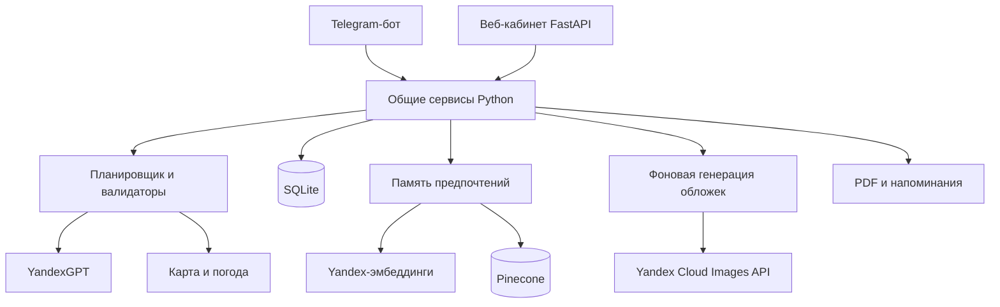

# Архитектура семейного планировщика путешествий

Приложение объединяет Telegram-бота и веб-кабинет. Они используют общую учётную запись, правила планирования и SQLite. ИИ подбирает места и интерпретирует пожелания, а код контролирует формат, ограничения и сохранение результата.

## Компоненты

| Слой | Основные файлы | Назначение |
| --- | --- | --- |
| Интерфейсы | `bot.py`, `anketa.py`, `web_app.py`, `web/` | Диалог, форма, личный кабинет, карта |
| Сценарии | `web_service.py`, `planner.py` | Создание и изменение поездки |
| Город | `city_candidates.py`, `city_planner.py`, `city_deterministic.py`, `city_edit_service.py` | Проверенные кандидаты, расписание, правка дня |
| Регион | `candidate_grounding.py`, `source_planning.py`, `regional_skeleton.py`, `regional_routing.py` | Границы территории, базы, карточки посещений и переезды |
| Данные и доступ | `schemas.py`, `db.py`, `access_control.py`, `web_auth.py`, `privacy.py` | Pydantic, SQLite, приглашения, сессии и удаление данных |
| Память | `memory.py`, `yandex_ai.py` | Поиск предпочтений по смыслу и дополнение контекста |
| Дополнительные функции | `generation_jobs.py`, `trip_covers.py`, `yandex_art.py`, `reminders.py`, `pdf_export.py` | Фоновые операции, иллюстрации, напоминания и PDF |

## Создание поездки

1. Проверяются анкета, доступ и квота. Дорога и жильё вычитаются из общего бюджета до планирования программы.
2. Собираются географические и погодные данные, при необходимости — память предпочтений пользователя.
3. Выбирается городской или региональный сценарий. Предложения модели не считаются подтверждёнными фактами без независимых проверок.
4. Проверяются структура, даты, время, повторы, семейные ограничения, география и бюджет. Неустранённая обязательная ошибка блокирует сохранение.
5. В веб-сценарии профиль, поездка и чек-лист сохраняются одной транзакцией. Telegram-бот сохраняет эти данные последовательными операциями.
6. После сохранения обновляется память; для новой веб-поездки может запускаться отдельная генерация обложки.

В `.env.example` для городов включены `CITY_CANDIDATES_FIRST=1` и `CITY_DETERMINISTIC_SCHEDULE=1`: модель помогает с кандидатами и предпочтениями, а расписание рассчитывает сервер. Исходные значения по умолчанию в коде остаются совместимыми со старой конфигурацией, поэтому оба параметра следует задавать явно.

При достаточных карточках условий посещения региональное расписание также строится сервером. Когда карточек нет, предусмотрена модельная ветка по проверенным местам. Если карточки есть, но допустимая программа по ним не получается, система объясняет ограничение, а не скрыто подменяет факты выдуманными.

Недостаток проверенного содержания может дать полный календарь с программными и явно свободными днями. Это характеристика найденного набора, а не доказательство отсутствия других мест в направлении.

Городской поиск начинает с выбранных категорий карты, подтверждает точные идентификаторы объектов и использует ограниченный резервный поиск при недоступности основного источника. Размер проверенного резерва зависит от длительности: до 24 мест для поездок до восьми дней, для более длинных — до 42. Дополнительные названия, подтверждения и HTTP-обращения имеют отдельные конечные лимиты. Подбор имён моделью не заменяет проверку карты.

Техническое завершение отделено от качества: `complete`, `partial`, `insufficient_data`. В сохранённой анкете отдельно фиксируются безопасные счётчики поиска и покрытие интересов; при правке дня качество пересчитывается по новому календарю. Неполная программа явно обозначается в кабинете и сообщении о завершении, а не выдаётся за полную.

В стандартной обзорной анкете проверенный резерв не сокращается моделью: посещения распределяет сервер с учётом интересов и ограничений. При наличии памяти модель может ранжировать резерв, но не удалять из него места. При отказе ранжирования остаётся серверный порядок с явным уведомлением. Нестандартная цель или текстовые пожелания текущей анкеты включают отдельный смысловой отбор; отвергнутые им места автоматически не возвращаются. Общий предел городского сценария — три вызова модели, без скрытых циклов.

## Изменение дня

Правка ограничивается выбранным днём. В городском сценарии разрешён только сохранённый набор кандидатов без мест других дней. После структурной проверки отдельный смысловой аудит оценивает выполнение пожелания. Проверка версии поездки защищает от перезаписи более новой правки. Отказ сохраняет прежний маршрут.

Перестановка двух дней без ИИ доступна в городском маршруте при сохранённом контексте для повторной проверки. Небезопасная перестановка отклоняется; региональные маршруты с переездами этим способом пока не переставляются. Удаление поездки запускает очистку связанных файлов и сохраняет технический учёт израсходованной квоты.

## Хранение и RAG

SQLite хранит анкеты, маршруты, чек-листы, квоты, приглашения, сессии, статусы задач и сведения об обложках. Файлы PDF, обложек и кэшей отделены от исходников. Pinecone хранит векторные записи предпочтений и отзывов в отдельной области пользователя; полные маршруты остаются в SQLite.

RAG здесь означает поиск подходящих записей памяти перед обращением к модели. Программа дополнительно проверяет владельца и направление, а текущая анкета важнее прежних предпочтений. Извлечённый текст считается справочными данными, не командами.

Для стандартной городской анкеты память — подсказка для приоритетов, не гарантия соблюдения произвольных условий из прошлых поездок. Обязательные ограничения нужно указывать в текущей анкете. Отдельные серверные запреты мест, возрастные, календарные и бюджетные проверки сохраняются независимо от ранжирования.

## Доступ и фоновые задачи

Режим `invite` разрешает доступ владельцу и временным гостям. Личное приглашение рассчитано на одного человека: пять общих попыток создания или ИИ-изменения поездки и отдельно пять попыток обложек за весь срок, не ежедневно. По умолчанию оно действует семь дней от создания; срок 1–30 суток задаёт владелец. Для сдачи выбран срок восемь суток. Просмотр, PDF и повторное открытие обложки не расходуют попытки, обычная правка маршрута не запускает новую картинку. Отдельный лимит операций памяти — три на приглашение. Подробности квот и отзыва приведены в [README](../README.md#демонстрационный-доступ-и-расходы).

Фоновая веб-генерация хранит статус задания и квитанцию в SQLite. Повтор с тем же ключом не должен создавать вторую платную операцию. После аварийного перезапуска незавершённая операция не повторяется платно автоматически.

Несмотря на историческое имя `yandex_art.py`, клиент использует Yandex Cloud Images API. Один синхронный запрос провайдеру выполняется в отдельном обработчике приложения. Неопределённый ответ не вызывает автоматическую повторную платную отправку. Ошибка обложки не удаляет сохранённую поездку. Свет, ракурс и выбранный сюжет задаются промптом, но точность архитектуры и визуальное качество не гарантируются; обложка обозначается как ИИ-иллюстрация, а не фотография.

## Размещение и границы

Docker Compose запускает один веб-процесс и один бот с общим постоянным томом `/data`. Контейнеры работают без привилегий; веб-порт доступен на loopback сервера, публичный HTTPS обеспечивает обратный прокси. Приложение опубликовано по адресу https://travel.product-ai-pav.ru. SQLite и локальные обработчики рассчитаны на небольшую нагрузку, а не распределённый кластер.

Карта подтверждает идентичность и положение места, но не его часы, цену или доступность. Бюджет предварительный, в одной валюте; автоматической конвертации, бронирования и оплаты нет. Для далёких дат погода может быть историческим ориентиром. Проверки снижают риск ошибок, но не гарантируют успешный маршрут для любой анкеты.

Полное описание для защиты находится в [авторском документе Word](submission/architecture.docx).
